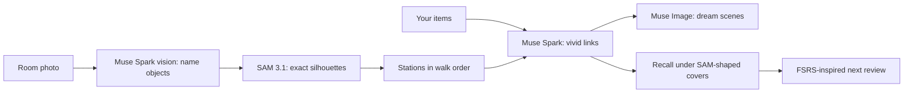
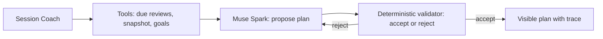

# Engrammo

[](https://github.com/McDumfly/engrammo/actions/workflows/ci.yml)

A research-based memory-training gym that teaches real mnemonic techniques instead of brain games — my entry for the **Meta Global AI Developer Hackathon** (Indie Dev Track), problem statement: **Build for Your World**.

## How judges test it in 60 seconds

1. `sh tool/bootstrap.sh && flutter run` (no key needed).
2. Guest → Practice → Room Palace → Try the sample room (labelled replay of a real run).
3. Use sample list → Build → dream scenes.
4. "First, test me without the palace", then Prove it.
5. Session Coach → See a real agent run.
6. Settings → Meta AI → key → Run live instead.

**60-second tour:**

- **Room Palace** — photograph your own room; Muse Spark names the stations, SAM 3.1 cuts their exact silhouettes as retrieval cues, Muse Image paints each fact onto them.
- **Session Coach** — a Muse Spark agent that reads your due reviews, weak spots and goals through tools and proposes a plan a deterministic validator accepts or rejects, with a visible trace.
- **Research-based curriculum** — 6 tracks, 36 chapters, 400+ short lessons on loci, spacing, testing effect and encoding specificity, with a 13-task starting assessment.

> The name comes from `engram`: the physical trace of a memory.
> It promises no photographic memory — that is a myth. Instead it
> teaches real techniques: memory palace, association,
> keyword method.

## Quickstart

```bash
git clone https://github.com/McDumfly/engrammo && cd engrammo
sh tool/bootstrap.sh
flutter run
```

Without a key everything runs on local fallbacks. With a
key, either write it into `.env` (`MODEL_API_KEY=`) or
paste it in-app under Settings → Meta AI.

## What does the app do?

1. **Starting assessment.** Spatial, visual, verbal, and
   working-memory tasks measure where you begin.
2. **Personalized path.** It builds short lessons from
   your starting level instead of pushing one template
   on everyone.
3. **Teach first, quiz later.** Every track opens with an
   explanation and a worked example; the first tasks are
   gentle and immediate. Mnemonic techniques: loci / memory
   palace, chaining, visual association, keyword method,
   number systems, if-then plans, poem learning, evening
   day-replay.
4. **Retrieval days later.** An FSRS-inspired scheduler
   (hand-tuned stability/difficulty rules, not fitted FSRS
   weights) schedules Room Palace reviews; path lessons
   use a fixed review ladder (1 → 60 days), building on
   sleep consolidation.
5. **Everyday goals + your own material.** Every lesson names
   what you use it for (exams, names, faces, numbers, years,
   birthdays, deadlines, tasks, poems, phone numbers,
   your whole day), and at the end the AI builds a task
   from YOUR material — what you want to remember, or what
   slipped away. Field practice and missions close the tracks.
6. **Gamification.** Level, rank, streak, short lessons,
   duel mode (Battle Zone), and league.
7. **Long program per track.** Every lesson can be replayed
   through 11 deeper practice rounds: more tasks, longer
   delays, higher difficulty, and a fresh task set every
   round. Rounds only unlock when due (spaced gate from
   1 day to 60 days), so a fully completed track is 800+
   short sessions (70+ hours of guided practice over many
   months) — past the 20-hour research dose — with its own
   clock and spaced-repetition signals (details:
   `docs/RESEARCH.md` §4).

## How Meta models are used

All calls go through one service,
`lib/services/meta_ai_service.dart`, with live Meta Model
API calls at runtime (base URL `https://api.meta.ai/v1`,
overridable via `META_API_BASE_URL`):

| Model | Where it shows in the demo |
| --- | --- |
| Muse Spark (`muse-spark-1.3`) | Lesson/practice stimuli, technique teaching, forgetting diagnosis, personal tasks from own material, post-lesson/duel recaps; vision spotting reads the learner's room photo into stations |
| Muse Spark — tool calling | Session Coach agent: reads due reviews/weak spots/goals via 3 tools, submits a plan that a deterministic validator accepts or rejects (self-correction loop, visible trace) |
| Muse Image (`muse-image-1.0`) | Palace illustration, Room Palace dream scenes of the learner's own objects, visual-scene image, lesson art, endless unique picture-recall rounds in practice |
| SAM 3.1 (`sam-3.1`) | Cuts exact object silhouettes out of the learner's own room photo — the covers ARE the retrieval cues (geometry only; names come from Spark spotting) |
| Muse Wonder (`muse-wonder-1.0`) | Spatial route preview from a second viewpoint |

Muse Glimmer and Muse Spark Open are open-weight and not
used in this build.

If the Meta API is unreachable or no key is set, local
generators provide the content, and every call is logged
(model name, time, success/error, whether fallback). The
call log is also viewable in the UI (Settings → Meta AI
→ recent calls) with per-model live/local counters.
Offline banner; local features keep working; bot duels
also work offline.





Detailed technical plan in the repo: `docs/META_TERV.md`.
Research background: `docs/RESEARCH.md` (loci + spaced
repetition + daily-habit pillars, with citations). All
code, text, and screens are original work, with no
copied code snippets, data, or trademarked visuals.

## Hackathon submission

- Track: Indie Dev (solo), problem statement **Build
  for Your World**. Judging per the Participant Guide:
  four equally weighted criteria on a 0–10 scale —
  Impact, Use of Meta AI Tooling, Technical Depth &
  Execution, Demo (plus a pass/fail Stage One: fits the
  theme and reasonably uses Meta Model API / Meta
  open-weight models).
- New work only: the Oct 26 initial commit is a plain
  `flutter create` scaffold; every line of app code,
  docs and tests landed Oct 27 – Nov 4, 2026, in
  day-stamped build commits (see `git log`). Nothing
  predates the building period.
- Not an anti-project: this is a full training system
  (curriculum, spaced schedule, assessment, duels,
  leagues), not an education chatbot and not medical
  advice — see the claims guardrail
  (`lib/models/claims_policy.dart`) and
  `docs/SUBMISSION.md`.
- This repo is public; the submission video is a
  3-minute demo of hackathon-built features only.
- Demo script, recording checklist and judging
  cross-reference: `docs/SUBMISSION.md`.
  Competition log: `docs/verseny-naplo.md`.

## Scientific basis (brief)

- Mechanical brain games alone do not train anything
  general (Simons et al. 2016; Owen et al., Nature) —
  so the app teaches encoding techniques instead of
  drilling reflexes.
- The loci method reorganizes memory networks within
  weeks (Maguire et al. 2003; Dresler et al. 2017;
  Wagner et al. 2021).
- For names and words: name-face imagery (Morris et al.
  1978) and the keyword method (Atkinson & Raugh 1975).
- For deadlines: if-then plans (Gollwitzer 1999); for poems:
  piecemeal recall (Rubin 1995); for the day: evening
  replay + sleep (Gais et al. 2006; Wilhelm et al. 2011).
- Repetition is spaced over days to weeks: an
  FSRS-inspired scheduler (hand-tuned stability/difficulty
  rules, not fitted FSRS weights) schedules Room Palace
  reviews; path lessons use a fixed review ladder (1 → 60
  days).

## Dueling as timed retrieval

The Battle Zone is not separate study material but timed
retrieval on research-faithful tasks: every round runs
memorize → hide → recall, the stimulus disappears on its
own, and only then comes the question. Three tasks per
duel, the same task with the same clock for both sides;
after the starting memory area two mixed areas follow
(interleaving). Answers use each paradigm's own format:
typed numbers and words, a tapped-back cell set, and only
meaning judgment stays 4-choice (the Rosch paradigm).
Partial recall earns partial points, speed bonus only for
exact answers; the reversed digit-span direction stays
hidden until recall. Each round ends with instant
corrective feedback plus the source. A missed or timed-out
round is not lost: the per-round breakdown of the match
is saved to history and can be reviewed in the Battle
Zone under "Past matches". Forfeiting counts as a loss
with minimal participation XP; draws close with a shared
result. Bot duels can start with no network (the device
assembles the 3 tasks), and the result is saved and
counts toward the league then too. Code:
`lib/models/battle_round.dart`,
`lib/screens/battle_duel_page.dart`,
`lib/services/bot_arena_store.dart`,
`lib/models/battle_rewards.dart`.

## What we do NOT promise (legally safe honesty)

- No higher IQ, better grades, or workplace performance,
  no protection against cognitive decline or dementia,
  and no photographic memory — the latter was never
  demonstrated under lab conditions.
- The first round of a completed path is the FOUNDATION:
  you tried every core technique once, on app material.
  The deeper practice rounds, spaced repetition, and your
  own material (your own palace, your own names, your own
  study content) take you past the 20-hour research dose
  (Dresler et al. 2017: ~20 hours over 6 weeks for ONE
  technique) — lasting knowledge takes weeks of practice,
  then re-measurement with fresh tasks.
- The 13-task assessment is a screener, not a diagnosis
  and not an IQ test; the "memory level" is an in-app
  practice metric, not a clinical measure.
- The app is an educational practice app, not a medical
  device. Forbidden promises are guarded in code by
  `lib/models/claims_policy.dart` + `test/claims_policy_test.dart`
  (for curriculum + coach-card + mission texts);
  the detailed mapping: `docs/RESEARCH.md` chapters 6, 9, 10.
  The same is shown in the app in the "What this app can — and
  cannot — do" notice.

## Screens

- Sign-in: Google, email/password, guest mode.
- Learning path, assessment, memory games
  (sequence, numbers, words, visual pattern, ordered
  recall), memory profile.
- Battle Zone duels, Brain League, avatar, settings
  (dark mode, haptics, account actions).

## Tech

- Flutter, Dart `^3.13.4`, `1.0.0+1`, `publish_to: none`.
- Icons: HugeIcons (neutral, non-Material set).
- Font: Lexend (variable weight 100–900) from a local asset,
  works offline, with Latin Extended accents.
- Firebase: Auth + Firestore sync (`users/{uid}`
  merge-writes, pull on sign-in, offline best-effort).
- Network: `http`, timeouted, best-effort Meta calls.
- State: plain `Listenable` + `MemoryStore`,
  no Riverpod / Bloc / router.

## Project structure

- `lib/main.dart` — startup, Firebase + settings load.
- `lib/screens/` — screens (path, assessment,
  memory games, battle, profile, settings).
- `lib/models/` — curriculum, spaced-schedule +
  FSRS card state, Meta task / image / segment models.
- `lib/services/` — auth, cloud sync, memory store,
  Meta AI service, settings.
- `lib/theme/`, `lib/widgets/`, `lib/utils/` — theme,
  shared buttons, navigation, streak helpers.
- `test/` — 128 test files (1165 tests): models,
  scheduler, Meta-service fallback, auth, sync,
  streak/engram economy, transfer tasks and missions,
  onboarding and screen flows, UI details
  (`flutter test`).
- `tool/run.sh` — launch script with a `.env` key (not bundled),
  `tool/build_release.sh` — obfuscated release build.

## Running

```bash
flutter pub get
flutter analyze
flutter test
```

With a live Meta call: copy `.env.example` to a gitignored
local `.env` file, put the key in once — a plain launch
picks it up automatically (the `.env` ships as a bundled
asset, and cloud AI is on by default), no key entry needed
in Settings:

```bash
flutter run
```

`sh tool/run.sh` works too: it passes the same `.env`
content as a `--dart-define` key. If a gitignored
`.env.json` exists (`{"MODEL_API_KEY":"..."}`), the script
prefers `--dart-define-from-file` instead, so the key never
shows up in the process list. For one occasion it can also
go by hand:

```bash
flutter run --dart-define=MODEL_API_KEY=YourKeyHere
```

A different key can still be entered under Settings → Meta
AI (override); it stays in encrypted storage on the device
(iOS Keychain / Android Keystore). Cloud AI can be switched
off in the same place.

Release build (obfuscated Dart code with the `--obfuscate` flag,
without a key):

```bash
sh tool/build_release.sh appbundle
```

The release script builds with an empty `.env`, so no key
is bundled: the user enters their own key in Settings.
Revoke the demo key on the Meta dashboard afterwards.

No connection required: with no network the app shows an
offline banner; local features keep working.
It also starts without Firebase config (but with
live net): then the app opens directly instead of the sign-in,
and all data stays on the device. For Firebase setup see:
`FIREBASE_SETUP.md` (EU region recommended, `flutterfire
configure --project=engrammo-app`). On Linux there is no
Firebase config yet, so the app runs device-local there
(also fine for judging the offline path).

## Note on the old description

I looked back through git history: earlier commits only had
the Flutter-template description (`A new Flutter project`),
a proper project intro nowhere. This file is the first real
description, based on the `~/Downloads/meta` materials and
today's code.
